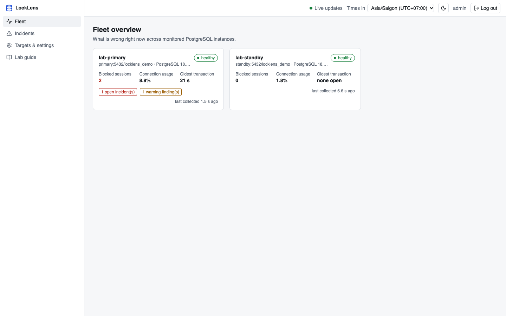
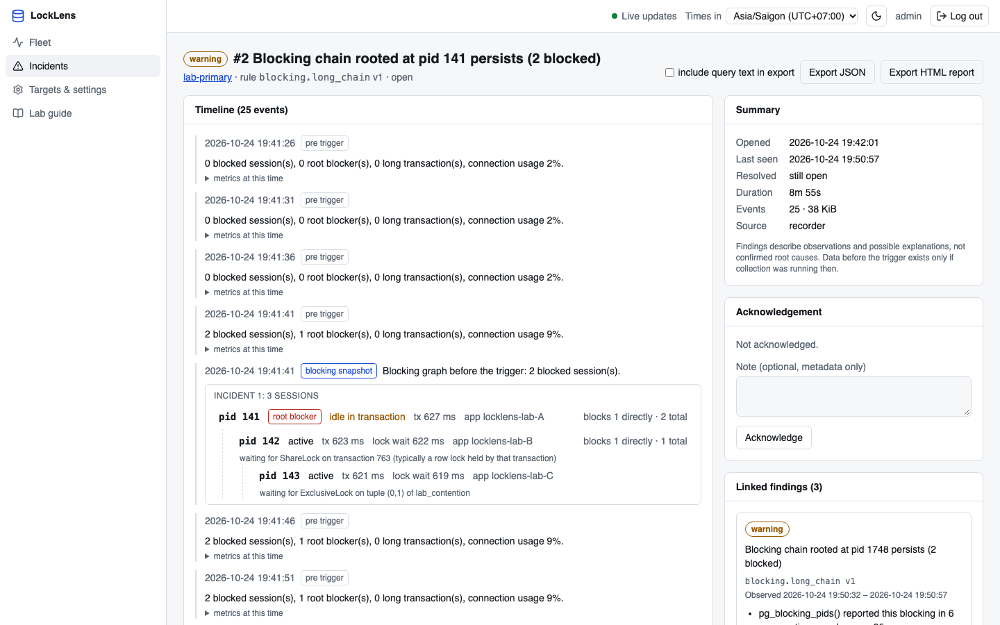

# LockLens

Open-source PostgreSQL monitoring and incident investigation.

LockLens watches your PostgreSQL instances, explains what is wrong right now —
blocking chains, idle-in-transaction blockers, connection pressure, slow
queries, vacuum and replication trouble — and records incidents with the
evidence you need afterwards. It is one Go binary: a web UI and API with
background collectors (`locklens server`) and a command-line tool for
one-off investigations (`locklens inspect`).

LockLens **only observes**. It connects with a read-only role in read-only
transactions and never cancels queries, terminates sessions, changes
configuration, creates or drops indexes, runs `VACUUM`, or fails over.



## Features

- **Fleet overview** of many instances: state (healthy, degraded,
  unreachable), freshness, open incidents, and current findings per target.
- **Health**: sessions by state, connections versus the limit, commit and
  rollback rates, cache hit ratio, temp files, deadlocks, WAL rate,
  checkpoints and background writer (version-aware), `pg_stat_io` on 16+,
  database sizes, oldest transactions.
- **Blocking investigation**: blocking trees from `pg_blocking_pids()`, root
  blockers, direct and transitive counts, lock modes and waiting relations,
  lock wait age from `pg_locks.waitstart`, prepared transactions, history of
  stored snapshots, offline analysis of CLI snapshot files.
- **Query workload** from `pg_stat_statements`: per-window totals, sorting,
  filtering, drill-down, comparison with the previous equal window, regression
  and volume flags with minimum-call thresholds, and explicit coverage
  (resets, evictions, gaps).
- **Vacuum and tables**: dead-tuple estimates, last (auto)vacuum/analyze,
  vacuum progress, sizes, transaction ID age.
- **Replication and WAL**: role, replicas with LSN and time lags, slots and
  retained WAL, standby receive/replay state, archiver failures.
- **Host metrics** (optional) from node_exporter.
- **Evidence-based findings** from 13 deterministic rules: what was observed,
  the evidence and its source, possible explanations (never a claimed root
  cause), next checks, and limitations. Missing data is reported as
  "insufficient data", never as "OK".
- **Incident recorder**: pre-trigger buffer, timeline of samples and blocking
  graphs, cooldown regrouping, size and duration limits, restart recovery,
  acknowledgement as metadata only.
- **Exports**: incident JSON (versioned, importable) and standalone HTML
  reports that open offline without LockLens.
- **Operations**: Prometheus `/metrics`, liveness and readiness probes,
  retention in batches, bounded buffering when the store is down, visible
  collection gaps.
- **Security**: single administrator with bcrypt and server-side sessions,
  CSRF protection, encrypted connection strings, query text off by default.



## Try it in about 10 minutes

Requirements: Docker with Compose v2 and `make`. Ports 8080 and 55432–55434 on
127.0.0.1 must be free.

```sh
git clone <this repository> locklens && cd locklens
make up                      # builds the image and starts the lab (first build: a few minutes)
```

Open <http://127.0.0.1:8080> and sign in as **admin** / **locklens-lab-admin**
(fake, local-only lab credentials). Two targets — a primary and a streaming
standby — are already registered. Then create a problem:

```sh
make lab SCENARIO=chain      # A -> B -> C blocking chain for 3 minutes
```

Watch it on the target's **Blocking** page; within about 20 seconds an
incident appears under **Incidents**. Other scenarios: `row-blocking`,
`idle-blocker`, `connection-pressure`, `regression`, `temp-files`,
`replication`, `healthy`, and `make lab-outage`. When done:

```sh
make down                    # removes the lab's containers and volumes
```

Step-by-step guide with expected results per scenario:
[docs/quickstart.md](docs/quickstart.md).

## Run it on your databases

```sh
make build-all               # Go 1.26+, Node.js 24.15+ (or 22.22.2+); produces bin/locklens with the UI embedded

export LOCKLENS_STORE_DSN='postgres://locklens_store:…@store-host:5432/locklens?sslmode=verify-full'
export LOCKLENS_MASTER_KEY="$(openssl rand -base64 32)"    # keep it safe: it encrypts stored DSNs
read -rs LOCKLENS_ADMIN_PASSWORD && export LOCKLENS_ADMIN_PASSWORD
bin/locklens server          # http://127.0.0.1:8080
```

The monitoring store is a separate PostgreSQL 14+ database that LockLens owns.
Monitored servers need PostgreSQL 14 or later and a login role with
`pg_read_all_stats`; `pg_stat_statements` is optional:

```sql
CREATE ROLE locklens_observer LOGIN PASSWORD '…';
GRANT pg_read_all_stats TO locklens_observer;
```

Add targets in **Settings → Add target**. All settings:
[docs/configuration.md](docs/configuration.md). Before exposing the UI
beyond your machine, read [docs/security.md](docs/security.md).

## Command line

The CLI works without the server, directly against a database:

```sh
export LOCKLENS_DSN='postgres://observer@db.example.internal:5432/app?sslmode=verify-full'
locklens doctor                                   # connectivity, version, privileges
locklens inspect                                  # blocking chains and long transactions, once
locklens watch                                    # refresh every 2 s
locklens snapshot save --out incident.json        # save for later (mode 0600)
locklens snapshot show incident.json              # offline
```

and with the monitoring store:

```sh
locklens server                                   # API, UI, collectors, incident recorder
locklens migrate                                  # apply store migrations and exit
locklens admin hash-password                      # bcrypt hash for LOCKLENS_ADMIN_PASSWORD_HASH
locklens incident export --id 42 --format html --out incident-42.html
locklens incident report incident-42.json --out incident-42.html   # offline rendering
```

Example: part of `locklens inspect` output during a blocking chain:

```text
Blocking chains (blocker -> waiter)
  Incident 1: root blocker pid 116 blocks 1 directly, 2 in total
    pid 116  idle in transaction  tx 3s  user=demo_app  app=locklens-demo-A  blocks 1 directly, 2 in total
    └─ pid 117  active  lock wait 3s  tx 3s  user=demo_app  app=locklens-demo-B  blocks 1 directly, 1 in total
          waiting for ShareLock on transaction 746 (typically a row lock held by that transaction)
       └─ pid 118  active  lock wait 3s  tx 3s  user=demo_app  app=locklens-demo-C
             waiting for ShareLock on transaction 747 (typically a row lock held by that transaction)
```

Reference: [docs/cli-reference.md](docs/cli-reference.md). Exit codes: `0`
success (including when blocking was found), `1` runtime failure, `2` invalid
usage or input.

## How it works

```text
 PostgreSQL targets ──(read-only, per-target pool)──► collectors ──► bounded write queue ──► monitoring store
                                                          │                                     │
                                                          ▼                                     ▼
                                                 rules + incident recorder              REST API + SSE ──► React UI
```

One worker per target runs its collectors sequentially (activity every
interval, counters ≥ 15 s, statements ≥ 60 s, replication ≥ 30 s, table
sizes every 5 minutes) under a global concurrency limit. Counters become
rates at ingest, with restarts, statistics resets, and gaps stored as unknown
rather than zero. Details: [docs/architecture.md](docs/architecture.md),
[docs/collectors.md](docs/collectors.md).

## Privacy and safety

- Query text is **off by default** and enabled per target; it never appears
  in logs, metric labels, or exports unless explicitly requested.
- Connection strings are encrypted at rest (AES-256-GCM) and never returned by
  the API or shown in the UI, logs, exports, or snapshots.
- The server listens on 127.0.0.1 by default; cookies are `HttpOnly` and
  `SameSite=Strict`; mutations require a CSRF token.
- Findings describe observations and possible explanations. Blocking is
  sampled and snapshots are not atomic; a cycle in sampled data is not called
  a confirmed deadlock.

## Repository structure and development

```text
locklens/
├── backend/            # Go module: cmd/, internal/, migrations/, demo/
├── web/                # React: src/app, features, components, api, lib, styles
├── deploy/             # Dockerfile and Compose definitions
├── demo/               # PostgreSQL fixtures and bootstrap targets
├── scripts/            # development, test, smoke, and lab entrypoints
├── tests/e2e/          # CLI, HTTP server, and browser tests
├── docs/
├── .github/workflows/
├── Makefile
├── README.md
├── CONTRIBUTING.md
├── SECURITY.md
└── LICENSE
```

Run these commands from the repository root (Go 1.26+, Node.js 24.15+ (or 22.22.2+), npm,
Docker Compose v2, make, Python 3, and curl):

```sh
make dev          # local API on :18080 + Vite on :5173 + lab databases
make build        # build React, embed its assets, build all binaries in bin/
make test         # backend unit tests + frontend typecheck, lint, unit tests
make demo         # CLI scenarios against the lab primary
make docker-smoke # isolated image build, migrations, HTTP/UI/CLI smoke checks
```

The development UI uses the lab login **admin** / **locklens-lab-admin**.
Ctrl-C stops the local development processes; `make down` removes the lab
containers and volumes. Use `make up` for the complete containerized app.

Unit tests stay beside their implementation. PostgreSQL package integration
tests also stay in `backend/internal/`; only cross-system tests live in
`tests/e2e/`. Frontend assets are generated into
`backend/internal/webui/dist/` before compiling Go, so embedding never reaches
outside a Go package. `make backend-build` is available for Go-only work;
`make build-all` remains an alias of `make build`.
See [development](docs/development.md) for package boundaries and setup.

## Testing

```sh
make check               # gofmt, go vet, unit tests, race detector, import separation
make web-check           # frontend typecheck, lint, unit and accessibility tests
make test-integration    # real PostgreSQL 14.24 and 18.6 in disposable Docker projects
make e2e                 # Playwright against the full Docker stack, no API mocks
```

Monorepo verification: [docs/monorepo-refactor.md](docs/monorepo-refactor.md).
Earlier functional test results: [docs/test-report.md](docs/test-report.md).

## Documentation

| Topic | Document |
| --- | --- |
| Getting started | [quickstart](docs/quickstart.md), [configuration](docs/configuration.md), [troubleshooting](docs/troubleshooting.md) |
| Concepts | [architecture](docs/architecture.md), [collectors](docs/collectors.md), [PostgreSQL observation](docs/postgresql-observation.md), [blocking graph](docs/blocking-graph.md), [query analysis](docs/query-analysis.md), [rules](docs/rules.md), [incidents](docs/incidents.md) |
| Operations | [storage and retention](docs/storage-and-retention.md), [security](docs/security.md), [limitations](docs/limitations.md) |
| Reference | [HTTP API](docs/api.md), [CLI](docs/cli-reference.md), [snapshot format](docs/snapshot-format.md) |
| Development | [development](docs/development.md), [testing](docs/testing.md), [test report](docs/test-report.md), [implementation plan](docs/implementation-plan.md), [CONTRIBUTING](CONTRIBUTING.md), [SECURITY](SECURITY.md) |

## Status

LockLens is young. Every test suite has passed locally against PostgreSQL
14.24, 15.19, 16.15, 17.11, and 18.6 (see the
[test report](docs/test-report.md)); it has not been run in production
environments yet. Performance
figures in the docs come from a local lab and are not guarantees. Known
limitations are listed in [docs/limitations.md](docs/limitations.md).

## License

MIT. See [LICENSE](LICENSE).
