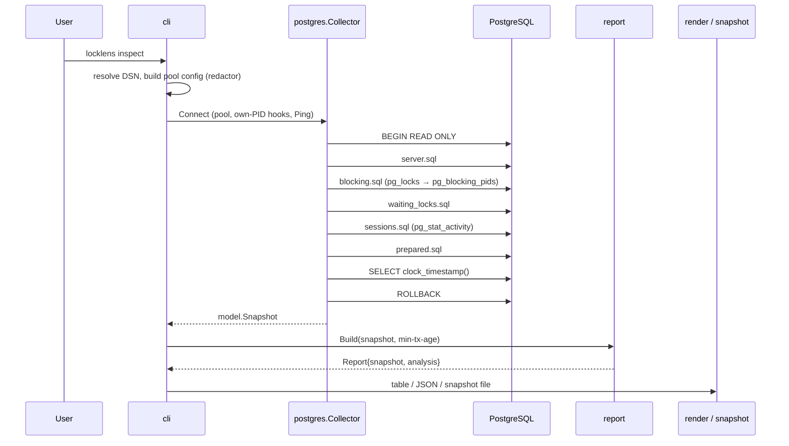

# Architecture

LockLens is a single Go binary. It has no server component, no state besides
optional snapshot files, and one external dependency at runtime: the PostgreSQL
server it observes.

## Components

```mermaid
flowchart LR
    subgraph cmd["cmd/locklens"]
        main
    end
    subgraph internal
        cli["cli<br/>commands, flags, exit codes"]
        config["config<br/>DSN precedence, pool settings, redaction"]
        postgres["postgres<br/>read-only collector, doctor, SQL files"]
        model["model<br/>snapshot schema v1"]
        snapshot["snapshot<br/>atomic save, validated load"]
        report["report<br/>analysis from a snapshot"]
        graph["graph<br/>blocker → waiter graph"]
        render["render<br/>table and JSON"]
        textsafe["textsafe<br/>rune truncation, terminal sanitising"]
    end
    subgraph demo["demo/ (writes; never imported by the CLI)"]
        scenario["scenario<br/>real lock contention"]
        orchestrator["cmd/locklens-demo"]
    end
    main --> cli
    cli --> config & postgres & snapshot & report & render
    postgres --> model & config & textsafe
    snapshot --> model
    report --> graph & model
    render --> report & textsafe
    orchestrator --> scenario
```

| Package | Responsibility | Depends on the database? |
| --- | --- | --- |
| `internal/cli` | Cobra commands, flag validation, exit codes, signal handling, `watch` loop and backoff | via `postgres` |
| `internal/config` | `--dsn` / `LOCKLENS_DSN` precedence, pgx pool configuration with observer session settings, credential redaction | no |
| `internal/postgres` | Connection pool, exclusion of LockLens' own PIDs, the collection queries (`sql/*.sql`, embedded), doctor checks, error hints | yes |
| `internal/model` | Snapshot types: raw observations only | no |
| `internal/snapshot` | Crash-safe, no-clobber file writes; decoding with schema version checks | no |
| `internal/graph` | Graph algorithms: deduplication, counts, roots, cycles, components | no |
| `internal/report` | Builds the analysis (node kinds, ages, long transactions, warnings) from a snapshot | no |
| `internal/render` | Table and JSON/NDJSON output | no |
| `internal/textsafe` | UTF-8-safe truncation and neutralisation of control characters | no |
| `internal/buildinfo` | Version metadata injected with `-ldflags` | no |
| `demo/scenario`, `demo/cmd/locklens-demo` | Create real contention for the demo and integration tests | yes (writes) |

Everything below `postgres` in the table is pure Go and unit tested without a
database.

## Data flow



`snapshot show` skips everything above `report`: it loads a `model.Snapshot`
from disk and continues with the same `report.Build` and `render` calls, which
is why live and offline reports are identical for the same data.

## Major design decisions

**Only `pg_blocking_pids()` defines edges.** Inferring conflicts from
`pg_locks` ignores mode compatibility and queue order. See
[postgresql-observation.md](postgresql-observation.md#why-pg_blocking_pids-and-not-a-pg_locks-self-join).

**Snapshots hold raw data; analysis is derived.** Storing counts or roots would
freeze today's interpretation into files. Deriving them keeps offline output
consistent with live output and lets a newer LockLens re-analyse old files.

**Read-only by construction.** Connections set
`default_transaction_read_only=on` and every collection runs in a
`READ ONLY` transaction. There is no code path that cancels or terminates
backends. Demo writes live in `demo/` and `make check-separation` (run in CI)
fails if the CLI ever imports it.

**Own connections are excluded by PID.** The pool's `AfterConnect` and
`BeforeClose` hooks record backend PIDs from the startup handshake. This is
reliable even if another client uses `application_name=locklens`.

**Server clock for ages.** `server_time` is read after all other sources, so
ages never go negative and client clock skew does not matter.

**Small pool, no overlap.** At most two connections (one in use, one to replace
a broken connection). `watch` runs collections sequentially in one goroutine,
so they cannot overlap regardless of how slow the server is.

**Timeouts at two levels.** `--query-timeout` bounds each collection through
the context (pgx cancels the query) and is also sent as `statement_timeout`, so
the server stops work even if the client disappears. `--connect-timeout`
bounds the dial and handshake.

**Cancellation is not an error.** Commands derive their context from SIGINT and
SIGTERM. `watch` treats cancellation as a normal exit (code 0) and suppresses
the resulting context errors.

**Retry with bounded backoff.** In `watch`, failures are retried after
`interval × 2^(n−1)`, capped at `max(30s, interval)`. Errors that retrying
cannot fix (authentication, missing database, permission, unsupported version)
stop the command.

**Credentials never reach output.** Unparsable DSNs are never echoed (pgx's own
message for that case is only best-effort redacted); other errors pass through
a redactor that replaces exact secret values. See [SECURITY.md](../SECURITY.md).

**Untrusted strings are neutralised at the edge.** Server strings are stored
as-is (JSON escaping makes them safe), and sanitised by `textsafe.Terminal`
when rendered as text.

## Dependencies

| Module | Why |
| --- | --- |
| `github.com/jackc/pgx/v5` | PostgreSQL driver and pool; native types, context cancellation, libpq-compatible DSN and TLS handling |
| `github.com/spf13/cobra` | Subcommands, help, and flag parsing |

Everything else (logging with `log/slog`, tables with `text/tabwriter`, JSON,
signals, TTY detection) uses the standard library.
