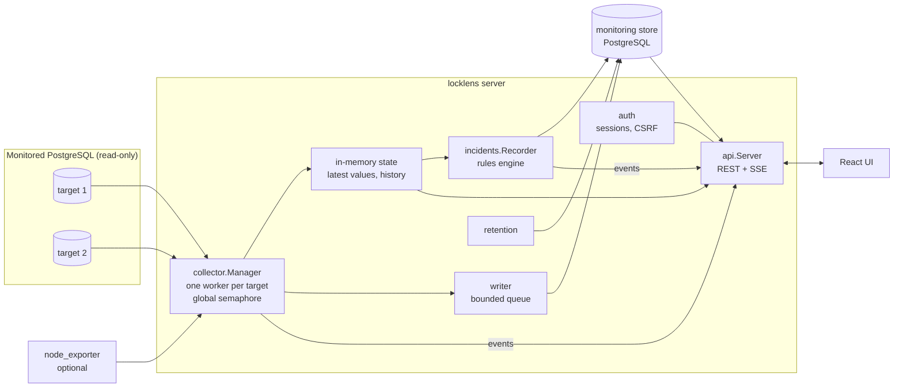
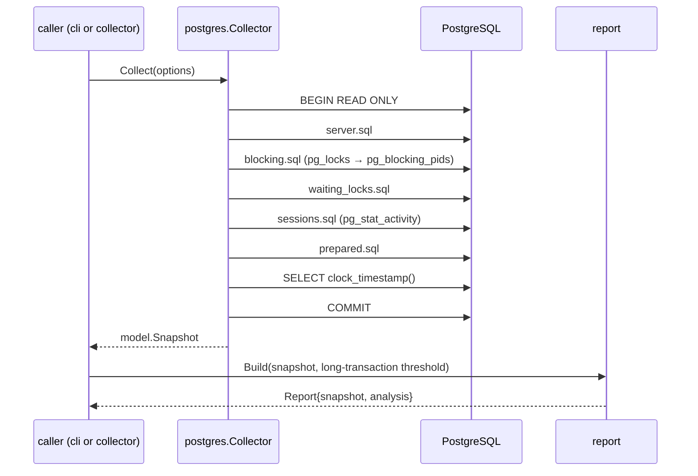

# Architecture

LockLens consists of a Go backend and a web frontend, shipped as two images
([deployment.md](deployment.md)). The backend binary has two modes:

- **CLI** (`doctor`, `inspect`, `watch`, `snapshot`): connects to one
  PostgreSQL server, collects once or repeatedly, prints a report. No state
  besides optional snapshot files.
- **Server** (`locklens server`): background collectors for many targets, a
  monitoring store, a rule engine and incident recorder, and a JSON API with
  server-sent events. It serves no UI.

The **frontend** is the React UI, built to static files and served by nginx,
which also proxies `/api/` to the backend so that the browser sees a single
origin.

Both modes share the same read-only collection code, blocking graph, and
report builder, so the CLI and the UI show the same analysis for the same
data.

## Server overview



### Request and data flow

1. **Targets** are stored in the monitoring store with the DSN encrypted
   (`backend/internal/lib/secret`, AES-256-GCM). `backend/internal/domain/targets` validates input,
   encrypts DSNs, tests connections, and notifies the manager.
2. **`collector.Manager`** keeps one worker goroutine per enabled target and
   re-reads targets when they change. Each worker owns a small pgx pool,
   detects capabilities, and runs its collectors sequentially on their own
   schedules (activity, database counters, statements, replication, tables,
   host). A global semaphore bounds concurrent runs across targets. See
   [collectors.md](collectors.md).
3. Collectors turn cumulative counters into rates/deltas at ingest
   (`collector/counters.go`, `collector/statements.go`), update the target's
   **in-memory state** (latest values and a bounded history, used for live
   pages and rules), and enqueue writes.
4. The **writer** applies batches to the store in order with retries. Its queue
   is bounded; when full, the oldest batch is dropped and later recorded as a
   collection gap.
5. After each activity collection, the **incident recorder** evaluates the
   rules (`backend/internal/domain/rules`) on the in-memory history, synchronises findings to
   the store, and opens, extends, or resolves incidents with evidence events.
   See [rules.md](rules.md) and [incidents.md](incidents.md).
6. The **API** (`backend/internal/transport/httpapi`) serves live values from memory and history from
   the store, authenticates every request (`backend/internal/domain/auth`), and publishes
   server-sent events (`target.collected`, `target.status`,
   `incident.updated`) that tell the UI which queries to refresh. See
   [api.md](api.md).
7. **Retention** (`backend/internal/domain/retention`) deletes expired rows hourly in small
   batches. See [storage-and-retention.md](storage-and-retention.md).

### Packages

| Package | Responsibility |
| --- | --- |
| `backend/internal/app` | Wiring and startup of `locklens server` (store and migrations, admin bootstrap, bootstrap targets, restart recovery), graceful shutdown |
| `backend/internal/config` | Server settings from the environment; PostgreSQL connection settings and credential redaction |
| `backend/internal/lib/logger` | Structured loggers (text or JSON) on stderr |
| `backend/internal/repository` | Monitoring store: embedded migrations with an advisory lock, all SQL for targets, metrics, statements, snapshots, findings, incidents, sessions, retention |
| `backend/internal/lib/secret` | AES-256-GCM sealing of DSNs with the master key |
| `backend/internal/domain/auth` | bcrypt passwords, server-side sessions, CSRF and Origin checks, login rate limiting |
| `backend/internal/domain/targets` | Target validation, encryption, connection tests, bootstrap file |
| `backend/internal/domain/collector` | Manager, per-target workers, collectors, counters and deltas, capability detection, writer, target state |
| `backend/internal/domain/observe` | Shared types for collected data (capabilities, points, statement deltas, replication, table health) |
| `backend/internal/lib/hostmetrics` | node_exporter scraping and parsing (size-limited) |
| `backend/internal/domain/rules`, `backend/internal/domain/finding` | Deterministic rules, thresholds, findings with evidence |
| `backend/internal/domain/incidents` | Incident recorder: pre-trigger buffer, lifecycle, limits, recovery |
| `backend/internal/domain/settings` | Rule thresholds persisted in the store (demo defaults in demo mode) |
| `backend/internal/domain/export` | Incident JSON (versioned) and standalone HTML reports; import validation |
| `backend/internal/transport/httpapi` | HTTP handlers, middleware (request IDs, security headers, limits), SSE hub |
| `backend/internal/lib/obs` | Prometheus-format metrics with bounded labels |
| `backend/internal/domain/retention` | Periodic cleanup loop |
| `backend/internal/domain/onboard` | Adding an instance from one connection string, including LockLens's own least-privilege roles |
| `web/` | React + TypeScript UI (Vite, React Router, TanStack Query, Apache ECharts, Tailwind CSS), its Dockerfile, and the nginx configuration of the frontend image |

### Frontend

The UI is a single-page app served by the Go binary from the same origin.
Routes put the selected target, time range, and filters in the URL. Data is
fetched with TanStack Query; server-sent events invalidate the relevant
queries instead of polling everything. The CSRF token is kept in memory; the
session cookie is HttpOnly. Pages: Fleet, Target overview, Queries, Query
detail, Blocking, Sessions, Tables, Replication, Incidents, Incident detail,
Settings (targets, thresholds, store size), Lab guide (demo mode).

### Concurrency and isolation

- One worker per target; collectors of a target never overlap.
- `LOCKLENS_MAX_CONCURRENT_COLLECTIONS` (default 4) caps runs across all
  targets; per-target pools hold 1–5 connections.
- Every collector run has a timeout; a failing or slow target affects only its
  own worker.
- The writer is the only component writing collected data to the store; its
  queue is bounded.
- The recorder serialises rule evaluation and incident updates with a mutex,
  so incidents of one target are updated in order.

### Startup and shutdown

Startup: load and validate configuration → open the store → apply
migrations → bootstrap the administrator → create bootstrap targets → reattach
open incidents (`recorder_restarted`) → start manager, writer, retention, HTTP
server. `/readyz` reports ready once the store answers.

Shutdown (SIGINT/SIGTERM): stop accepting requests and finish in-flight ones,
cancel workers (closing their pools), and let the writer flush queued batches
for up to 5 seconds, all within `LOCKLENS_SHUTDOWN_TIMEOUT`. Batches still
queued after that are lost.

## CLI components

```mermaid
flowchart LR
    subgraph cmd["backend/cmd/locklens"]
        main
    end
    subgraph internal
        cli["cli<br/>commands, flags, exit codes"]
        config["config<br/>DSN precedence, pool settings, redaction"]
        postgres["postgres<br/>read-only collector, doctor, SQL files"]
        model["model<br/>snapshot schema v1"]
        snapshot["snapshot<br/>atomic save, validated load"]
        report["report<br/>analysis from a snapshot"]
        graph["graph<br/>blocker → waiter graph"]
        render["render<br/>table and JSON"]
        textsafe["textsafe<br/>rune truncation, terminal sanitising"]
    end
    subgraph demo["demo/ (writes; never imported by locklens)"]
        scenario["scenario<br/>real lock contention"]
        orchestrator["backend/cmd/locklens-demo"]
        lab["lab, backend/cmd/locklens-lab<br/>lab scenarios"]
    end
    main --> cli
    cli --> config & postgres & snapshot & report & render
    postgres --> model & config & textsafe
    snapshot --> model
    report --> graph & model
    render --> report & textsafe
    orchestrator --> scenario
    lab --> scenario
```

| Package | Responsibility | Depends on the database? |
| --- | --- | --- |
| `backend/internal/transport/cli` | Cobra commands, flag validation, exit codes, signal handling, `watch` loop and backoff; `server`, `migrate`, `admin`, `incident` commands | via `postgres` / `server` |
| `backend/internal/config` | `--dsn` / `LOCKLENS_DSN` precedence, pgx pool configuration with observer session settings, credential redaction | no |
| `backend/internal/lib/postgres` | Connection pool, exclusion of LockLens' own PIDs, the activity collection queries (`sql/*.sql`, embedded), read-only transactions, doctor checks, error hints | yes |
| `backend/internal/domain/model` | Snapshot types: raw observations only | no |
| `backend/internal/lib/snapshot` | Crash-safe, no-clobber file writes; decoding with schema version checks | no |
| `backend/internal/domain/graph` | Graph algorithms: deduplication, counts, roots, cycles, components | no |
| `backend/internal/domain/report` | Builds the analysis (node kinds, ages, long transactions, warnings) from a snapshot | no |
| `backend/internal/lib/render` | Table and JSON/NDJSON output | no |
| `backend/internal/lib/textsafe` | UTF-8-safe truncation and neutralisation of control characters | no |
| `backend/internal/lib/buildinfo` | Version metadata injected with `-ldflags` | no |
| `backend/demo/scenario`, `backend/cmd/locklens-demo`, `backend/demo/lab`, `backend/cmd/locklens-lab` | Create real contention for the demo, the lab, and integration tests | yes (writes) |

### Activity collection



`snapshot show`, the server's stored snapshots, and incident blocking graphs
all re-run `report.Build` on stored raw snapshots, which is why live and
offline analyses match for the same data.

## Major design decisions

**Only `pg_blocking_pids()` defines edges.** Inferring conflicts from
`pg_locks` ignores mode compatibility and queue order. See
[postgresql-observation.md](postgresql-observation.md#why-pg_blocking_pids-and-not-a-pg_locks-self-join).

**Snapshots hold raw data; analysis is derived.** Storing counts or roots would
freeze today's interpretation. Deriving them keeps offline output consistent
with live output and lets a newer LockLens re-analyse old data.

**Read-only by construction.** Connections set
`default_transaction_read_only=on` and every collection runs in a `READ ONLY`
transaction. There is no code path that cancels or terminates backends or
changes a target. Writes for demos and the lab live in `demo/`, and
`make check-separation` (run in CI) fails if `locklens` ever imports it.

**Unknown is not zero.** Counter deltas that cannot be computed (first sample,
restart, stats reset, decrease, long gap) are stored as NULL and shown as gaps;
rules treat missing data as "insufficient data".

**Live data from memory, history from the store.** Latest values and the
current activity report come from the worker's in-memory state, so they do
not wait for the store; charts, findings, and incidents read the store.

**Rules are code, not configuration.** Each rule is a deterministic, versioned
Go function with tests; only thresholds are configurable. Findings carry
evidence and limitations, and possible explanations are never presented as
confirmed causes.

**Incidents copy their evidence.** Incident events hold the snapshots and
values they need, so raw-history retention never changes an incident, and
exports are self-contained.

**Own connections are excluded by PID.** The pool's `AfterConnect` and
`BeforeClose` hooks record backend PIDs from the startup handshake, which is
reliable even if another client uses `application_name=locklens`.

**Server clock for ages.** `server_time` is read after all other sources, so
ages never go negative and client clock skew does not matter.

**Timeouts at two levels.** Contexts bound each collection on the client and
`statement_timeout` bounds it on the server, so the server stops work even if
the client disappears.

**Credentials never reach output.** Unparsable DSNs are never echoed; other
errors pass through a redactor that replaces exact secret values; the API never
returns DSNs. See [security.md](security.md).

## Dependencies

| Module | Why |
| --- | --- |
| `github.com/jackc/pgx/v5` | PostgreSQL driver and pool; context cancellation, libpq-compatible DSN and TLS handling |
| `github.com/spf13/cobra` | Subcommands, help, and flag parsing |
| `golang.org/x/crypto` | bcrypt for the administrator password |

Everything else in Go (HTTP routing with `net/http`, logging with `log/slog`,
AES-GCM, templates, embedding) uses the standard library. Frontend
dependencies are pinned in [web/package.json](../web/package.json).

## On-demand investigation boundary

`backend/internal/domain/workspace` uses target-specific capabilities and an encrypted DSN,
separate from collector pools. Requests acquire bounded concurrency, connect with a
restricted role, begin a read-only transaction, execute bounded catalog/data/cursor
queries, audit safe metadata and discard the connection. There is no background table
reader or workspace result-history table. Migration 0003 adds policies, audit metadata
and explicit replication mappings. The React workspace uses CodeMirror with nonce-based
CSP styles; application SQL/result text is rendered as text, never HTML.

See [investigation workspace](investigation-workspace.md) for execution limits,
credential isolation, topology evidence and operational limitations.
