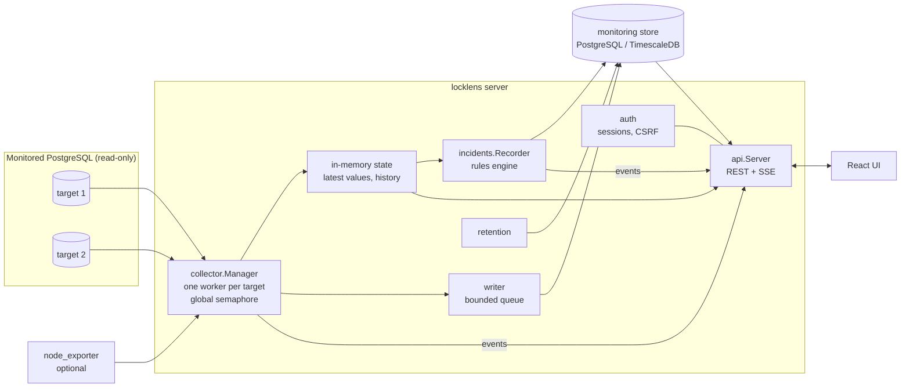
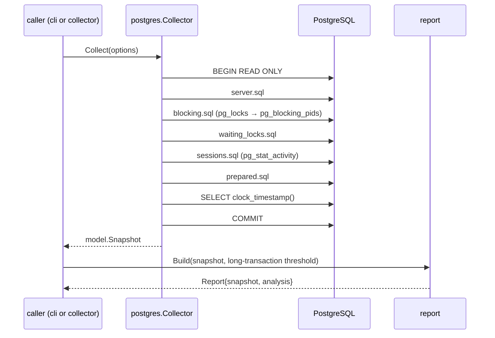

# Architecture

LockLens consists of a Go backend and a web frontend, shipped as two images
([deployment.md](deployment.md)). The backend binary has two modes:

- **CLI** (`doctor`, `inspect`, `watch`, `snapshot`): connects to one
  PostgreSQL server, collects once or repeatedly, prints a report. No state
  besides optional snapshot files.
- **Server** (`locklens server`): background collectors for many targets, a
  monitoring store, a rule engine and incident recorder, and a JSON API with
  server-sent events. It serves no UI.

The **frontend** is the React UI, built to static files and served by nginx,
which also proxies `/api/` to the backend so that the browser sees a single
origin.

Both modes share the same read-only collection code, blocking graph, and
report builder, so the CLI and the UI show the same analysis for the same
data.

## Server overview



### Request and data flow

1. **Targets** are stored in the monitoring store with the DSN encrypted
   (`backend/internal/lib/secret`, AES-256-GCM). `backend/internal/domain/targets` validates input,
   encrypts DSNs, tests connections, and notifies the manager.
2. **`collector.Manager`** keeps one worker goroutine per enabled target and
   re-reads targets when they change. Each worker owns a small pgx pool,
   detects capabilities, and runs its collectors sequentially on their own
   schedules (activity, database counters, statements, replication, tables,
   host). A global semaphore bounds concurrent runs across targets. See
   [collectors.md](collectors.md).
3. Collectors turn cumulative counters into rates/deltas at ingest
   (`collector/counters.go`, `collector/statements.go`), update the target's
   **in-memory state** (latest values and a bounded history, used for live
   pages and rules), and enqueue writes.
4. The **writer** applies batches to the store in order with retries. Its queue
   is bounded; when full, the oldest batch is dropped and later recorded as a
   collection gap.
5. After each activity collection, the **incident recorder** evaluates the
   rules (`backend/internal/domain/rules`) on the in-memory history, synchronises findings to
   the store, and opens, extends, or resolves incidents with evidence events.
   See [rules.md](rules.md) and [incidents.md](incidents.md).
6. The **API** (`backend/internal/transport/httpapi`) serves live values from memory and history from
   the store, authenticates every request (`backend/internal/domain/auth`), and publishes
   server-sent events (`target.collected`, `target.status`,
   `incident.updated`) that tell the UI which queries to refresh. See
   [api.md](api.md).
7. **Retention** (`backend/internal/domain/retention`) deletes expired rows hourly in small
   batches. See [storage-and-retention.md](storage-and-retention.md).

### Packages

The backend is layered. Each layer only depends on the ones below it, and
SQL lives only in the two `queries` packages, never in Go files of the
domain:

```text
backend/
├── cmd/locklens/                 entry point: the CLI (server, agent, doctor, inspect, …)
├── migrations/                   monitoring store schema, numbered SQL files (embedded)
└── internal/
    ├── app/                      composition root: builds and wires everything for `locklens server`
    ├── config/                   settings from the environment, DSN parsing and redaction
    ├── transport/                how requests come in
    │   ├── httpapi/              REST + SSE: handlers_<area>.go; Deps (server.go) and repositories.go list what it uses
    │   └── cli/                  cobra commands: one file per command (agent.go, server.go, …)
    ├── domain/                   business logic, no SQL, one package per concern
    │   ├── <area>/               a service: its interface (Service, Manager, …) next to its implementation,
    │   │                         repositories.go names the repository interfaces it uses
    │   ├── observe/ live/        shared data types (collected data, catalog, changes, log events); a target's live view
    │   ├── events/               event publishing (Publisher) and this server's subscribers (Hub)
    │   ├── collector/            manager, per-target workers, one file per collector
    │   ├── rules/ finding/       deterministic rules and findings
    │   ├── incidents/            incident recorder
    │   ├── insight/              impact scores and hypotheses (uses changes and logs)
    │   ├── optimizer/            recommendations, life cycle, what-if
    │   ├── changes/              change timeline: diffs of settings, server facts, schema; reports
    │   ├── logs/                 log event classification, redaction, ingest validation, summaries
    │   ├── cluster/              several servers: leases, singleton jobs, message bus
    │   ├── tokens/               API tokens for machines (pipelines, log agents)
    │   └── …                     auth, targets, onboard, workspace, notify, baseline, rollup, retention, settings, export, plans, report, graph
    ├── repository/               monitoring store: executes SQL and scans rows (one file per area)
    │   └── queries/              the store's SQL: <area>/<name>.sql embedded by <area>.go; builders.go fills templates from fixed lists
    ├── targetdb/                 the monitored PostgreSQL: connections, read-only collection (one file per area)
    │   ├── queries/              the SQL sent to monitored servers, same layout
    │   └── investigate/          the on-demand investigation workspace (catalog, data, EXPLAIN, what-if)
    ├── agent/                    the log agent runtime: tailing, spool, shipping
    └── lib/                      generic helpers with no LockLens knowledge (pglog, sqlparse, secret, obs, …)
```

Where to make a change:

| To change | Look in |
| --- | --- |
| A query against the monitoring store | `repository/queries/<area>/*.sql`, then the Go method in `repository/<area>.go` |
| A query sent to monitored servers | `targetdb/queries/<area>/*.sql`, then `targetdb/<area>.go` |
| What a collector reads or how often | `domain/collector/<collector>.go` and the job list in `worker.go` |
| A rule or threshold | `domain/rules/` and `domain/settings/` |
| An API endpoint | `transport/httpapi/handlers_<area>.go`, routes in `server.go`, dependencies in `Deps` (`server.go`) |
| What a service offers | its interface, declared above its implementation in the service's package (for example `targets.Service` in `domain/targets/targets.go`) |
| The schema of the store | a new file in `migrations/` |
| Wiring (which implementation is used) | `app/app.go` |

#### Interfaces

An interface is declared in the package that implements it, next to the
implementation, and describes what that package offers:

- **Repositories.** Each file of `repository` declares the interface of its
  area (`TargetRepository` in `targets.go`, `IncidentRepository` in
  `incidents.go`, …) with a compile-time check that `*Store` implements it. A
  package that uses the store lists the areas it needs in a `Repositories`
  struct (`repositories.go`) that embeds those interfaces, so what it may
  touch is visible at a glance; `app` fills it with the store.
- **Services.** Each domain service declares its interface (`targets.Service`,
  `collector.Manager`, `incidents.Recorder`, `cluster.Node`, `cluster.Bus`,
  `events.Publisher`, …); the implementation is unexported and the
  constructor returns the interface. Other packages (and `httpapi.Deps`)
  depend only on these interfaces; tests substitute fakes.
- **No interface where there is a single concrete use**: the connection and
  read code for monitored servers (`targetdb`), generic libraries (`lib/…`),
  pure functions and data types (`rules`, `plans`, `report`, `graph`,
  `observe`, `live`), the log agent runtime, and the collector's writer (used
  only inside `collector`). `app` and the CLI, which build everything, hold
  `*repository.Store` itself.

Callbacks go in the direction of the data: the incident recorder returns
what the collector should do (collect a target faster) instead of calling
back into it, so no package depends on another in both directions.

| Package | Responsibility |
| --- | --- |
| `internal/app` | Wiring and startup of `locklens server` (store and migrations, admin bootstrap, bootstrap targets, cluster membership, singleton jobs), graceful shutdown |
| `internal/config` | Server settings from the environment; PostgreSQL connection settings and credential redaction |
| `internal/repository` | Monitoring store: embedded migrations with an advisory lock, TimescaleDB setup when available, execution and scanning of the SQL in `repository/queries` |
| `internal/targetdb` | Connections to monitored servers (read-only transactions, timeouts) and the collection reads, with the SQL in `targetdb/queries` |
| `internal/targetdb/investigate` | The investigation workspace's operations: catalog browsing, data, EXPLAIN, HypoPG what-if, managed roles |
| `internal/domain/collector` | Manager, per-target workers, collectors, counters and deltas, writer, target state, per-database connections, live views for other servers |
| `internal/domain/observe` | Shared types for collected data, catalogs, change events, log events |
| `internal/domain/live` | A target's live view (latest data, recent metric history, collector status), built by the collector and read by rules, the recorder, and the API |
| `internal/domain/events` | `Publisher` and `Subscriber` interfaces and the hub that delivers this server's events to its browsers |
| `internal/domain/rules`, `internal/domain/finding` | Deterministic rules, thresholds, findings with evidence |
| `internal/domain/baseline` | Statement baselines from five-minute rollups |
| `internal/domain/insight` | Impact scores and ranked hypotheses from findings, waits, changes, and server log events |
| `internal/domain/optimizer` | Recommendations per database from its catalog and workload, life cycle, HypoPG what-if |
| `internal/domain/changes` | The change timeline: diffs of settings, restarts, promotions, upgrades, and schema; reported deploys |
| `internal/domain/logs` | Classification of server log records into events, redaction, ingest validation, summaries |
| `internal/domain/cluster` | Several servers sharing a store: heartbeats, target leases, singleton jobs, LISTEN/NOTIFY bus |
| `internal/domain/tokens` | API tokens (hashed) with a scope and an optional instance |
| `internal/domain/incidents` | Incident recorder: pre-trigger buffer, lifecycle, limits, adoption of a target's open incidents |
| `internal/domain/auth` | bcrypt passwords, server-side sessions, CSRF and Origin checks, login rate limiting |
| `internal/domain/targets`, `internal/domain/onboard` | Target validation and encryption; adding an instance from one connection string |
| `internal/domain/workspace` | Policy and connection handling of the investigation workspace |
| `internal/domain/notify` | Notification channels, deliveries, reminders |
| `internal/domain/rollup`, `internal/domain/retention` | Metric rollups; periodic cleanup |
| `internal/domain/settings`, `internal/domain/export`, `internal/domain/plans` | Thresholds; incident exports; saved EXPLAIN parsing and comparison |
| `internal/agent` | The log agent: follows log files (rotation, positions), batches, spools, ships |
| `internal/lib/pglog` | Reading PostgreSQL logs: jsonlog, csvlog, stderr with log_line_prefix |
| `internal/lib/sqlparse` | PostgreSQL's parser (pg_query_go, cgo): analysis, normalisation, fingerprints; a lexical normaliser without cgo |
| `internal/lib/secret`, `internal/lib/obs`, `internal/lib/hostmetrics`, `internal/lib/logger` | AES-GCM sealing, metrics, node_exporter scraping, loggers |
| `internal/transport/httpapi` | HTTP handlers, middleware, the SSE stream |
| `internal/transport/cli` | The command-line interface, including `locklens agent` |
| `web/` | React + TypeScript UI (Vite, React Router, TanStack Query, Apache ECharts, Tailwind CSS) and the nginx frontend image |

### Frontend

The UI is a single-page app served by the Go binary from the same origin.
Routes put the selected target, time range, and filters in the URL. Data is
fetched with TanStack Query; server-sent events invalidate the relevant
queries instead of polling everything. The CSRF token is kept in memory; the
session cookie is HttpOnly. Pages: Fleet, Target overview, Queries, Query
detail, Blocking, Sessions, Tables, Replication, Incidents, Incident detail,
Settings (targets, thresholds, store size), Lab guide (demo mode).

### Concurrency and isolation

- One worker per target; collectors of a target never overlap.
- `LOCKLENS_MAX_CONCURRENT_COLLECTIONS` (default 4) caps runs across all
  targets; per-target pools hold 1–5 connections.
- Every collector run has a timeout; a failing or slow target affects only its
  own worker.
- The writer is the only component writing collected data to the store; its
  queue is bounded.
- The recorder serialises rule evaluation and incident updates with a mutex,
  so incidents of one target are updated in order.
- With several servers on one store, each target is collected by exactly one
  server at a time (a lease), and each once-per-cluster job runs on one
  server (see [Several servers](#several-servers)).

### Startup and shutdown

Startup: load and validate configuration → open the store → apply
migrations → bootstrap the administrator → create bootstrap targets → join
the cluster (heartbeat, bus) → start manager, writer, singleton jobs
(retention, rollups, baselines, optimizer, notification reminders), HTTP
server. When the manager starts collecting a target (at startup or after
taking it over), the recorder reattaches its open incidents
(`recorder_restarted`). `/readyz` reports ready once the store answers.

Shutdown (SIGINT/SIGTERM): stop accepting requests and finish in-flight ones,
cancel workers (closing their pools), and let the writer flush queued batches
for up to 5 seconds, all within `LOCKLENS_SHUTDOWN_TIMEOUT`. Batches still
queued after that are lost.

## Several databases per instance

A target names which databases tables, indexes, the catalog, and optimizer
recommendations come from (`database_scope`): only the connection string's
database (default), every database the role can connect to (at most 20), or
a list. Cluster-wide data (sessions, statements, replication, settings) is
read once on the main connection; each other database gets one extra
connection, opened on first use and retried after a minute when it fails.
Tables and indexes carry their database; recommendations are kept per
database; what-if checks run only on the connection string's database.

## Change timeline

The `changes` collector reads `pg_settings` and the server facts
(`pg_postmaster_start_time()`, `pg_conf_load_time()`, recovery state,
version) every minute; the catalog collector's schema (tables, index
definitions and validity) is compared every 15 minutes. Each reading is
compared with the previous one (kept in `change_state`), and what differs is
recorded in `change_events` with the window in which it happened. Settings
that can hold secrets (connection strings, shell commands) are compared by a
fingerprint. People and pipelines report deploys and migrations
(`POST /api/v1/changes`, with a session or an API token). Changes are drawn
on every chart of an instance and weighed by the insight engine as leads,
never as confirmed causes.

## Several servers

Several `locklens server` processes can share one monitoring store, for
availability. Each registers in `servers` with a heartbeat. On every sync
(15 s) the manager asks the cluster which targets it collects: a server
renews its leases (`leases`, `target:<id>`, 45 s) up to an even share,
releases the rest, and takes free or expired ones. A stopped server releases
its leases; a crashed one loses them when they expire, so its targets move
within about a minute. Once-per-cluster jobs hold a `job:<name>` lease.

Browser events are published on the server that observed them and carried
to the others over PostgreSQL `LISTEN/NOTIFY`, as are requests (collect a
target now) and settings changes. The collecting server publishes each
target's live view to `live_state` every 5 seconds while it is not alone, so
any server answers API requests for any target.

## Log agent

`locklens agent` runs on the database host and never connects to
PostgreSQL. It follows the log files (jsonlog, csvlog, or stderr with
`log_line_prefix`), keeps read positions, and turns messages into events:
slow statements, auto_explain plans, lock waits, deadlocks, autovacuum and
autoanalyze runs, temporary files, checkpoints, and errors. Statement texts
are normalised (constants become `$n`, with PostgreSQL's parser when the
build has it), plan conditions and error messages are redacted, and DETAIL
lines of errors are dropped before anything leaves the host. Batches go to
`POST /api/v1/ingest/logs` with a token of scope `ingest` that belongs to
one instance; while the server cannot be reached, they are spooled to disk.

## CLI components

```mermaid
flowchart LR
    subgraph cmd["backend/cmd/locklens"]
        main
    end
    subgraph internal
        cli["cli<br/>commands, flags, exit codes"]
        config["config<br/>DSN precedence, pool settings, redaction"]
        postgres["postgres<br/>read-only collector, doctor, SQL files"]
        model["model<br/>snapshot schema v1"]
        snapshot["snapshot<br/>atomic save, validated load"]
        report["report<br/>analysis from a snapshot"]
        graph["graph<br/>blocker → waiter graph"]
        render["render<br/>table and JSON"]
        textsafe["textsafe<br/>rune truncation, terminal sanitising"]
    end
    subgraph demo["demo/ (writes; never imported by locklens)"]
        scenario["scenario<br/>real lock contention"]
        orchestrator["backend/cmd/locklens-demo"]
        lab["lab, backend/cmd/locklens-lab<br/>lab scenarios"]
    end
    main --> cli
    cli --> config & postgres & snapshot & report & render
    postgres --> model & config & textsafe
    snapshot --> model
    report --> graph & model
    render --> report & textsafe
    orchestrator --> scenario
    lab --> scenario
```

| Package | Responsibility | Depends on the database? |
| --- | --- | --- |
| `backend/internal/transport/cli` | Cobra commands, flag validation, exit codes, signal handling, `watch` loop and backoff; `server`, `migrate`, `admin`, `incident` commands | via `postgres` / `server` |
| `backend/internal/config` | `--dsn` / `LOCKLENS_DSN` precedence, pgx pool configuration with observer session settings, credential redaction | no |
| `backend/internal/targetdb` | Connection pool, exclusion of LockLens' own PIDs, the activity collection queries (`queries/snapshot/*.sql`, embedded), read-only transactions, doctor checks, error hints | yes |
| `backend/internal/domain/model` | Snapshot types: raw observations only | no |
| `backend/internal/lib/snapshot` | Crash-safe, no-clobber file writes; decoding with schema version checks | no |
| `backend/internal/domain/graph` | Graph algorithms: deduplication, counts, roots, cycles, components | no |
| `backend/internal/domain/report` | Builds the analysis (node kinds, ages, long transactions, warnings) from a snapshot | no |
| `backend/internal/lib/render` | Table and JSON/NDJSON output | no |
| `backend/internal/lib/textsafe` | UTF-8-safe truncation and neutralisation of control characters | no |
| `backend/internal/lib/buildinfo` | Version metadata injected with `-ldflags` | no |
| `backend/demo/scenario`, `backend/cmd/locklens-demo`, `backend/demo/lab`, `backend/cmd/locklens-lab` | Create real contention for the demo, the lab, and integration tests | yes (writes) |

### Activity collection



`snapshot show`, the server's stored snapshots, and incident blocking graphs
all re-run `report.Build` on stored raw snapshots, which is why live and
offline analyses match for the same data.

## Major design decisions

**Only `pg_blocking_pids()` defines edges.** Inferring conflicts from
`pg_locks` ignores mode compatibility and queue order. See
[postgresql-observation.md](postgresql-observation.md#why-pg_blocking_pids-and-not-a-pg_locks-self-join).

**Snapshots hold raw data; analysis is derived.** Storing counts or roots would
freeze today's interpretation. Deriving them keeps offline output consistent
with live output and lets a newer LockLens re-analyse old data.

**Read-only by construction.** Connections set
`default_transaction_read_only=on` and every collection runs in a `READ ONLY`
transaction. There is no code path that cancels or terminates backends or
changes a target. Writes for demos and the lab live in `demo/`, and
`make check-separation` (run in CI) fails if `locklens` ever imports it.

**Unknown is not zero.** Counter deltas that cannot be computed (first sample,
restart, stats reset, decrease, long gap) are stored as NULL and shown as gaps;
rules treat missing data as "insufficient data".

**Live data from memory, history from the store.** Latest values and the
current activity report come from the worker's in-memory state, so they do
not wait for the store; charts, findings, and incidents read the store.

**Rules are code, not configuration.** Each rule is a deterministic, versioned
Go function with tests; only thresholds are configurable. Findings carry
evidence and limitations, and possible explanations are never presented as
confirmed causes.

**Incidents copy their evidence.** Incident events hold the snapshots and
values they need, so raw-history retention never changes an incident, and
exports are self-contained.

**Own connections are excluded by PID.** The pool's `AfterConnect` and
`BeforeClose` hooks record backend PIDs from the startup handshake, which is
reliable even if another client uses `application_name=locklens`.

**Server clock for ages.** `server_time` is read after all other sources, so
ages never go negative and client clock skew does not matter.

**Timeouts at two levels.** Contexts bound each collection on the client and
`statement_timeout` bounds it on the server, so the server stops work even if
the client disappears.

**Credentials never reach output.** Unparsable DSNs are never echoed; other
errors pass through a redactor that replaces exact secret values; the API never
returns DSNs. See [security.md](security.md).

## Dependencies

| Module | Why |
| --- | --- |
| `github.com/jackc/pgx/v5` | PostgreSQL driver and pool; context cancellation, libpq-compatible DSN and TLS handling |
| `github.com/spf13/cobra` | Subcommands, help, and flag parsing |
| `golang.org/x/crypto` | bcrypt for the administrator password |
| `github.com/pganalyze/pg_query_go/v6` | PostgreSQL's own SQL parser (libpg_query) for statement analysis in the query optimizer. C code: the server is built with cgo; without cgo the parser is reported unavailable and only catalog-based recommendations are made |

Everything else in Go (HTTP routing with `net/http`, logging with `log/slog`,
AES-GCM, templates, embedding) uses the standard library. Frontend
dependencies are pinned in [web/package.json](../web/package.json).

## On-demand investigation boundary

`backend/internal/domain/workspace` uses target-specific capabilities and an encrypted DSN,
separate from collector pools. Requests acquire bounded concurrency, connect with a
restricted role, begin a read-only transaction, execute bounded catalog/data/cursor
queries, audit safe metadata and discard the connection. There is no background table
reader or workspace result-history table. Migration 0003 adds policies, audit metadata
and explicit replication mappings. The React workspace uses CodeMirror with nonce-based
CSP styles; application SQL/result text is rendered as text, never HTML.

See [investigation workspace](investigation-workspace.md) for execution limits,
credential isolation, topology evidence and operational limitations.
