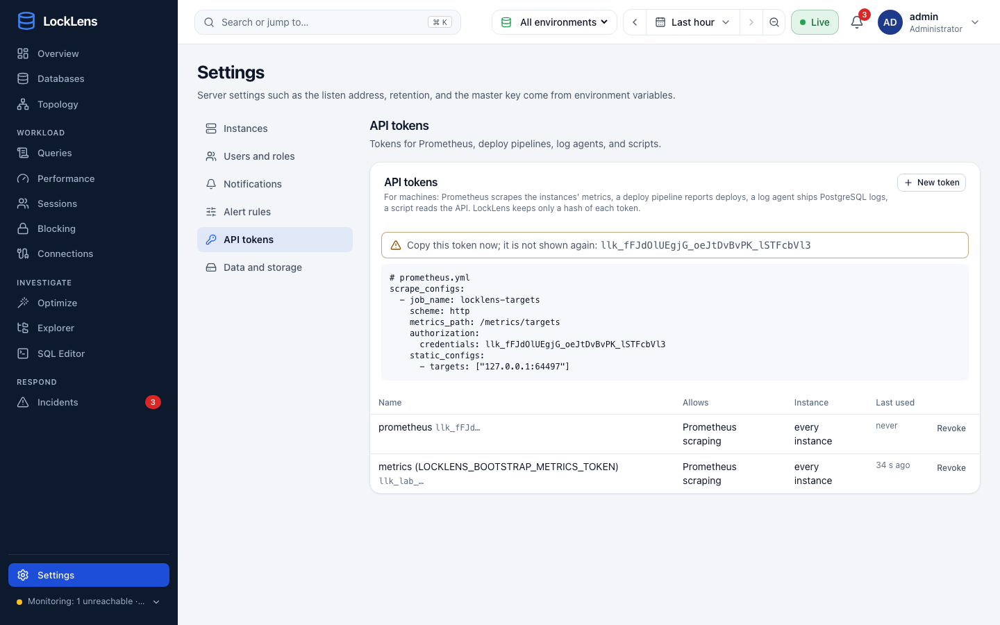
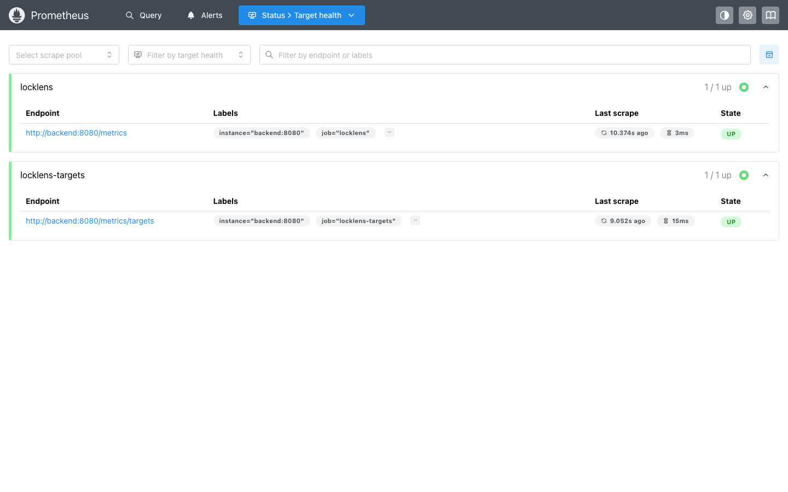
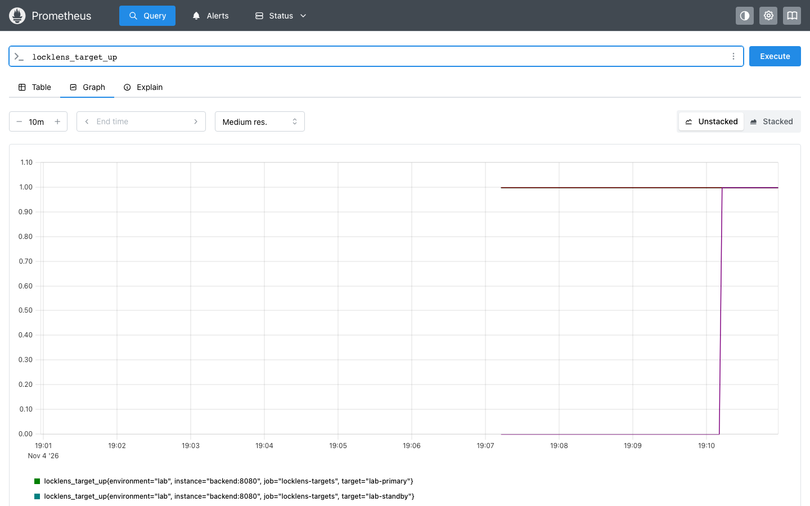
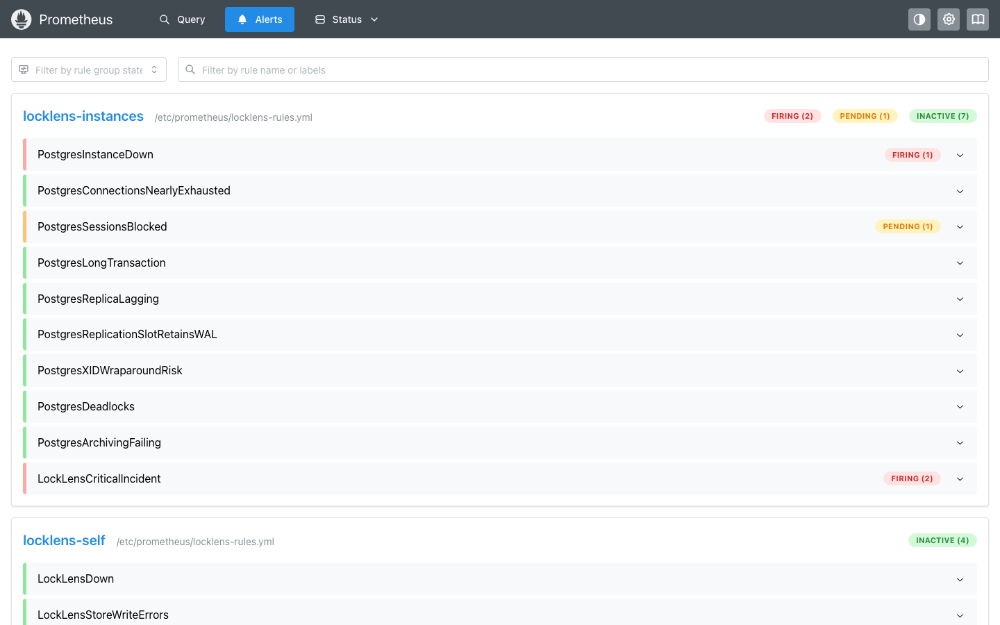
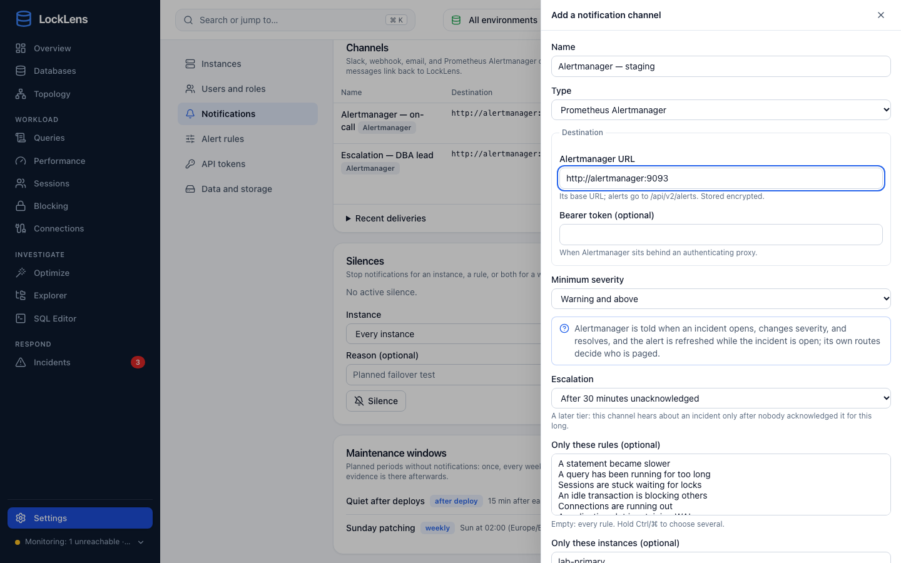
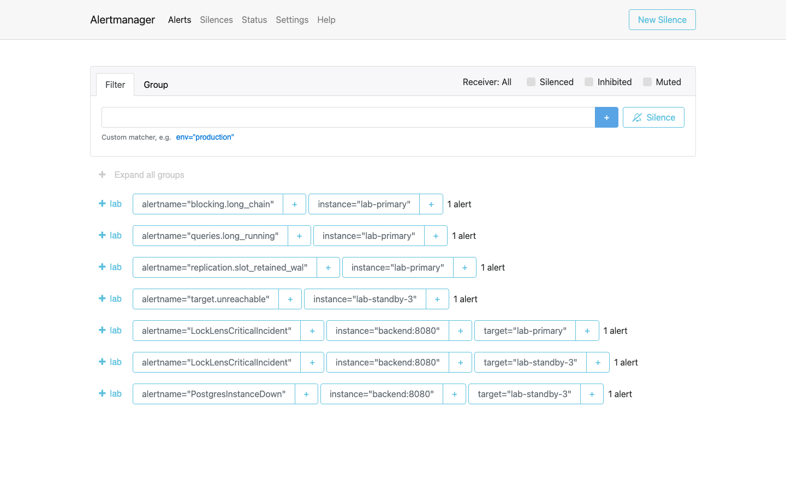

# Integrations

LockLens keeps its own history, rules, and incidents, and also hands what it
knows to the monitoring systems you already run:

| To | How | Direction |
| --- | --- | --- |
| Prometheus (and anything that scrapes its format: VictoriaMetrics, Grafana Agent/Alloy, Datadog, …) | `GET /metrics/targets` with an API token of scope `metrics` | pulled |
| Prometheus Alertmanager (and through it PagerDuty, Opsgenie, Teams, …) | Notification channel of type **Alertmanager** | pushed |
| OpenTelemetry collectors | OTLP/HTTP metrics push (`LOCKLENS_OTLP_ENDPOINT`) | pushed |
| Grafana | The dashboard in [deploy/observability/grafana](../deploy/observability/grafana/locklens-instances.json), on Prometheus | — |
| Scripts, reports | The REST API with an API token of scope `read` | pulled |
| Deploy pipelines | `POST /api/v1/changes` with a token of scope `events` ([api.md](api.md#changes)) | pushed |

## Prometheus

Create a token under **Settings → API tokens → New token**, allowing
*Prometheus scraping*; the page shows the scrape configuration with the token
filled in. Limit it to one instance if this Prometheus should see
only that instance. Then scrape LockLens:

```yaml
scrape_configs:
  # The PostgreSQL instances LockLens monitors, through the frontend (which
  # proxies /metrics/targets) or straight to the backend.
  - job_name: locklens-targets
    scheme: https
    metrics_path: /metrics/targets
    authorization:
      credentials_file: /etc/prometheus/locklens-token
    static_configs:
      - targets: ["locklens.example.com"]
  # LockLens itself (collectors, store writes, HTTP): only on the backend,
  # which the frontend does not publish.
  - job_name: locklens
    static_configs:
      - targets: ["locklens-backend:8080"]
```

The frontend image proxies `/metrics/targets` (never `/metrics`), so the
instances' metrics are reachable at the address users open.



`/metrics/targets` always needs the token. `/metrics` (LockLens' own health)
is open unless `LOCKLENS_METRICS_REQUIRE_TOKEN=true`. For automation,
`LOCKLENS_BOOTSTRAP_METRICS_TOKEN=llk_…` stores a token at startup, so
Prometheus can be configured before LockLens first runs.

With [several servers](architecture.md#several-servers), each server exports
the instances it collects: scrape every server. A takeover moves an
instance's series to the other server's scrape; the series stay the same
(their labels do not name the server).





### Metrics

Every series carries `target` (the instance's name in LockLens) and
`environment`. Values are in base units: seconds, bytes, ratios between 0
and 1.

| Metric | Type | Labels | Meaning |
| --- | --- | --- | --- |
| `locklens_target_up` | gauge | | 1 when LockLens collected the instance's activity within three intervals, 0 when it cannot |
| `locklens_target_info` | gauge | `server_version`, `role` | Always 1 |
| `locklens_target_last_collection_timestamp_seconds` | gauge | | Last activity collection |
| `locklens_pg_sessions` | gauge | `state` (`active`, `idle`, `idle_in_transaction`, `waiting_lock`, `unknown`) | Client sessions |
| `locklens_pg_connections_used`, `_max`, `_reserved`, `_usage_ratio` | gauge | | Connection slots |
| `locklens_pg_blocked_sessions`, `locklens_pg_blocking_root_sessions`, `locklens_pg_lock_wait_max_seconds` | gauge | | Blocking |
| `locklens_pg_transactions_open`, `_long`, `locklens_pg_transaction_oldest_age_seconds`, `locklens_pg_idle_in_transaction_oldest_age_seconds` | gauge | | Transactions |
| `locklens_pg_cache_hit_ratio` | gauge | | Over the latest collection interval |
| `locklens_pg_replicas`, `locklens_pg_replica_replay_lag_bytes`, `locklens_pg_replication_slot_retained_bytes`, `locklens_pg_standby_replay_delay_bytes` | gauge | `replica`, `slot` | Replication |
| `locklens_pg_database_size_bytes`, `locklens_pg_database_xid_age` | gauge | `database` | Per database |
| `locklens_pg_xact_commit_total`, `_rollback_total`, `locklens_pg_blocks_read_total`, `_hit_total`, `locklens_pg_tuples_{returned,fetched,inserted,updated,deleted}_total` | counter | | Throughput |
| `locklens_pg_temp_files_total`, `locklens_pg_temp_bytes_total`, `locklens_pg_deadlocks_total` | counter | | Spills and deadlocks |
| `locklens_pg_checkpoints_{timed,requested}_total`, `locklens_pg_checkpoint_buffers_written_total`, `locklens_pg_bgwriter_buffers_clean_total`, `locklens_pg_buffers_alloc_total`, `locklens_pg_io_{reads,writes}_total` | counter | | Writes and I/O |
| `locklens_pg_wal_bytes_total`, `locklens_pg_wal_received_bytes_total`, `locklens_pg_archiver_{archived,failed}_total` | counter | | WAL |
| `locklens_pg_statement_calls_total`, `locklens_pg_statement_exec_seconds_total` | counter | | All statements (pg_stat_statements) |
| `locklens_host_*` | gauge, counter | `mountpoint` | node_exporter values LockLens reads (CPU, memory, disk, network, filesystems) |
| `locklens_findings_active`, `locklens_incidents_open` | gauge | `rule`, `severity` | LockLens' own findings and incidents |
| `locklens_pg_statement_calls_per_second`, `locklens_pg_statement_mean_seconds` | gauge | `queryid`, `database`, `user` | Only with `LOCKLENS_EXPORT_TOP_STATEMENTS=N`: the N statements with the most time in the latest collection |

Counters are **running totals of what LockLens observed** since it started
collecting the instance: use `rate()` and `increase()`. They restart from
zero when LockLens restarts (Prometheus treats that as a counter reset), and
a missed collection is missing from them, as it is from LockLens' history.
Statement metrics never carry SQL text; `queryid` links them to the statement
pages of LockLens.

### Alerting rules and dashboard

[deploy/observability/locklens-rules.yml](../deploy/observability/locklens-rules.yml)
has rules for LockLens itself (down, failed store writes, dropped data,
stale collection) and for the instances (down, connections, blocking, long
transactions, replica lag, slots, wraparound, deadlocks, archiving, and open
critical incidents). `promtool check rules` validates them. They apply one
threshold everywhere; LockLens' own incidents apply its per-environment and
per-instance settings ([rules.md](rules.md#modes-and-overrides)). Use one or the
other for each condition so nobody is paged twice.



[deploy/observability/grafana/locklens-instances.json](../deploy/observability/grafana/locklens-instances.json)
is a Grafana dashboard on these metrics, with environment and instance
filters.

## Alertmanager



A notification channel of type **Alertmanager** posts incidents to
Alertmanager's `/api/v2/alerts` (optional bearer token). Alertmanager's
routes then decide who is paged, with your existing receivers.

| Label | Value |
| --- | --- |
| `alertname` | The rule, for example `target.unreachable` |
| `severity` | `info`, `warning`, `critical` |
| `instance`, `environment` | The instance's name and environment in LockLens |
| `rule`, `incident_id`, `source="locklens"` | |

Annotations: `summary` (the title), `description` (observations), `url` (the
incident, with `LOCKLENS_PUBLIC_URL`).



An open incident is posted with an end
10 minutes ahead and refreshed every 2 minutes, so Alertmanager keeps it
firing while it is open (and resolves it if LockLens stops); a resolved
incident is posted with its end. Silences and maintenance windows of LockLens
also hold these posts back.

## OpenTelemetry

`LOCKLENS_OTLP_ENDPOINT=http://otel-collector:4318/v1/metrics` pushes the
same metrics every `LOCKLENS_OTLP_INTERVAL` (60 s) over OTLP/HTTP (JSON):
gauges as gauges, counters as cumulative monotonic sums.
`LOCKLENS_OTLP_HEADERS=name=value,…` adds headers (an API key). The
resource has `service.name=locklens` and `service.instance.id` (the server).

## Reading the API

A token of scope `read` reads the REST API like a viewer
(`Authorization: Bearer …`, GET only). It is for scripts and reports; anything
that changes LockLens needs a person's session.

## Try it in the lab

```bash
docker compose -f deploy/compose.yaml -f deploy/compose.lab.yaml -f deploy/compose.observability.yaml \
  --env-file deploy/lab.env up -d --build
```

Prometheus (http://127.0.0.1:9090) scrapes the lab's LockLens with a fake
token and loads the rules; Alertmanager (http://127.0.0.1:9093) receives
Prometheus' alerts and those of a LockLens Alertmanager channel pointing to
`http://alertmanager:9093`.
